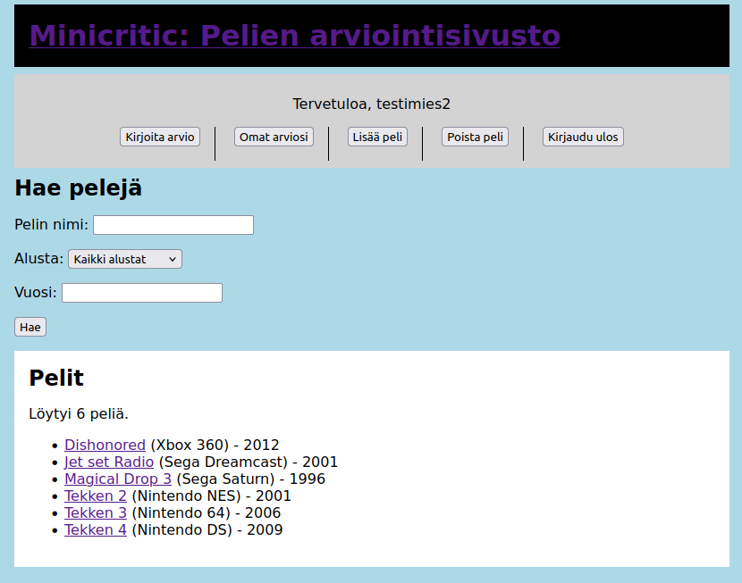

# Videopelien arviointi sivusto



## Sovelluksen toiminnot

- Käyttäjä voi luoda tunnuksen ja kirjautua sisään sivustolle.
- Käyttäjä voi etsiä vidopelejä nimen, konsolin, ja vuoden persuteella ja selata niiden arvioita.
- Käyttäjä voi kirjoittaa arvion videopelille.
- Käyttäjä voi päivittää kirjoittamiaan arvioita ja poistaa niitä
- Käyttäjä voi lukea tietyn käyttäjän tekemät arviot heidän profiilissaan.
- Käyttäjä voi antaa arviolle peukun ylös, tai alas

Käyttäjät voivat tehdä arvion vain olemassa oleville peleille. Eli aloittaessaan arviota, käyttäjä valitsee pelin, joka löytyy peli-tietokannasta.

Pelit ovat pääasiallinen tietokohde, arviot ovat toissijainen tietokohde, ja peukut ovat kolmassijainen tietokohde.
Pelejä ei tarkoituksella pysty muokkaamaan, koska muuten käyttäjä voisi tehdä sabotaasia keräämällä tietylle pelille arvioita, ja sitten muuttamaan pelin tietoja.
Pelejä voi poistaa, jos niillä ei ole arvioita, koska emme halua arvioiden poistuvan. Toisaalta, jos käyttäjä tekee virheen peliä lisäessään, he voivat poistaa sen ennen kuin kukaan antaa sille arvion. Lisäksi, sivusto pitää huolen, että jokaisella pelillä on eri nimi, ettei duplikaatteja tapahdu.
Arvioita ja peukkuja voi muokata ja poistaa. Peukun poisto tapahtuu peukutusnapin uudelleen napauttamisella.

## Sovelluksen kuvaus

Nettisivustomme on yksinkertainen abstraktio Metacritic-sivuston tapaisesta videopelien arviointisivusta. Tiedot peleistä elävät ensimmäisessä tietokannassa. Yksi entry tietokannassa sisältää pelin nimen, alustan (konsoli, pc), julkaisuvuoden, ja pelin lisänneen käyttäjän. Kun käyttäjä etsii sivustolta videopelin, he näkevät kaikki sille annetut arviot, ja keskiarvon, joka on väliltä 1-10 tähteä. Tämä keskiarvo lasketaan dynaamisesti jokaisen pelihaun yhteydessä. Kun käyttäjä kirjoittaa arvion pelille, he aloittavat etsimällä pelin nimeltä. Se täytyy löytyä ensimmäisestä tietokannasta. Käyttäjä saa kirjoittaa arvion (max 500 merkkiä) ja antaa 1-10 tähteä. Arvio tallennetaan toissijaisena tietokohteena. Kolmassijaisena tietokohteena on peukutukset, joita voi lisätä arvioihin.
Tietokohteiden riippuvaisuussuhde on Pelit < Arviot < Peukut.

## Ohjeet

Kloonaa repositorio, jonka jälkeen aja:

```
python3 -m venv venv
```

```
source venv/bin/activate
```

```
pip install flask
```

```
sqlite3 users.db < users.sql
```

```
sqlite3 games.db < games.sql
```

```
flask run
```

Lopuksi, navigoi osoiteeseen http://127.0.0.1:5000
Voit luoda sivustolle oman käyttäjän, ja kirjoittaa arvioita. Ennen arviontien kirjoittamista täytyy kuitenkin luoda ensiksi pelejä.
